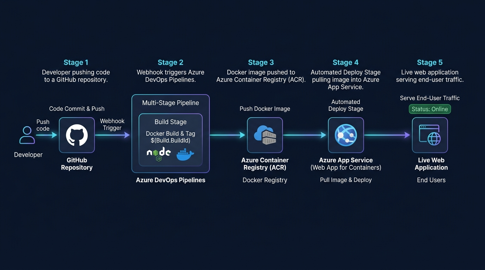

# Azure DevOps CI/CD Pipeline 🚀

A containerized Node.js web application deployed with a fully automated CI/CD pipeline using **Docker**, **Azure Container Registry (ACR)**, **Azure App Service**, and **Azure DevOps Pipelines**.

---

## 📌 Overview

This project demonstrates an enterprise-grade DevOps workflow for modern web applications. Every commit pushed to the `main` branch triggers an automated Azure DevOps multi-stage pipeline that builds a lightweight Docker container, pushes it to Azure Container Registry, and deploys it with zero manual intervention to Azure App Service.

---

## 🔄 Architecture & Workflow



```text
  ┌─────────────────┐
  │   Developer     │
  └────────┬────────┘
           │ Git Push (main)
           ▼
  ┌─────────────────┐
  │  GitHub Repo    │
  └────────┬────────┘
           │ Webhook Trigger
           ▼
┌──────────────────────────────────────────────┐
│            Azure DevOps Pipeline             │
│                                              │
│  [ Stage 1: Build & Push ]                   │
│  • Builds Docker image (node:22-alpine)      │
│  • Tags with $(Build.BuildId)                │
│  • Pushes to Azure Container Registry (ACR)  │
│                                              │
│  [ Stage 2: Deploy ]                         │
│  • Depends on Build stage                    │
│  • Deploys image to Azure App Service        │
└──────────────────────┬───────────────────────┘
                       │
                       ▼
          ┌─────────────────────────┐
          │    Azure App Service    │
          │    (Live Application)   │
          └─────────────────────────┘
```

---

## 🛠️ Tech Stack

- **Runtime & Web Framework**: [Node.js](https://nodejs.org/) (v22), [Express.js](https://expressjs.com/)
- **Containerization**: [Docker](https://www.docker.com/) (Alpine Linux base)
- **Cloud Infrastructure**: [Microsoft Azure](https://azure.microsoft.com/)
  - Azure Container Registry (ACR)
  - Azure App Service (Web App for Containers)
- **CI/CD Orchestration**: [Azure DevOps Pipelines](https://azure.microsoft.com/en-us/products/devops/pipelines) (YAML-based multi-stage pipeline)
- **Version Control**: [GitHub](https://github.com/)

---

## 📂 Project Structure

```text
.
├── .dockerignore         # Docker ignore rules (node_modules, .env, git)
├── Dockerfile            # Optimized Alpine-based multi-stage build
├── README.md             # Project documentation
├── assets/
│   └── architecture.jpg  # Architecture diagram
├── azure-pipelines.yml   # Multi-stage CI/CD pipeline definition
├── package.json          # Project metadata and dependencies
├── package-lock.json     # Dependency lockfile
└── server.js             # Express server with landing page & /health endpoint
```

---

## ⚙️ CI/CD Pipeline Stages

The pipeline is defined in [`azure-pipelines.yml`](./azure-pipelines.yml) and executes two distinct stages:

### 1. Build Stage (`Build and Push`)
- Triggers automatically on changes to `main`.
- Runs on a configured Azure DevOps self-hosted or Microsoft-hosted agent.
- Builds the Docker image from [`Dockerfile`](./Dockerfile).
- Authenticates with Azure Container Registry using an Azure DevOps Service Connection.
- Tags the image with the unique build identifier `$(Build.BuildId)` and pushes to ACR.

### 2. Deploy Stage (`Deploy to Azure App Service`)
- Runs conditionally only when the `Build` stage succeeds (`dependsOn: Build`, `condition: succeeded()`).
- Pulls the specific build artifact `$(containerRegistry)/$(imageRepository):$(tag)`.
- Updates Azure App Service using the `AzureWebAppContainer@1` task.

---

## 🩺 Application Endpoints

| Endpoint | Method | Description |
| :--- | :--- | :--- |
| `/` | `GET` | Responsive status dashboard showing active deployment |
| `/health` | `GET` | Health check endpoint for uptime and monitoring probes |

### Health Check Example

**Request:**
```bash
curl http://localhost:3000/health
```

**Response (`200 OK`):**
```json
{
  "status": "healthy",
  "service": "Azure CI/CD Application",
  "timestamp": "2026-10-18T19:30:00.000Z",
  "environment": "development"
}
```

---

## 🐳 Running Locally

### Option 1: Native Node.js

1. **Install dependencies:**
   ```bash
   npm install
   ```

2. **Start the application:**
   ```bash
   npm start
   ```

3. **Access the application:**
   Open [http://localhost:3000](http://localhost:3000) in your browser.

---

### Option 2: Docker Container

1. **Build the Docker image:**
   ```bash
   docker build -t azure-cicd-app .
   ```

2. **Run the container:**
   ```bash
   docker run -d -p 3000:3000 --name azure-app azure-cicd-app
   ```

3. **Verify running container:**
   ```bash
   docker ps
   curl http://localhost:3000/health
   ```

4. **Stop the container:**
   ```bash
   docker stop azure-app && docker rm azure-app
   ```

---

## ☁️ Azure Setup & Configuration

To set up this CI/CD pipeline in your own Azure environment:

1. **Create Azure Resources:**
   - Azure Container Registry (e.g., `myacr.azurecr.io`)
   - Azure App Service plan (Linux) with Web App for Containers

2. **Configure Azure DevOps:**
   - Create an Azure DevOps Project.
   - Establish two **Service Connections**:
     1. **Docker Registry Connection**: Connecting Azure DevOps to your ACR.
     2. **Azure Resource Manager Connection**: Connecting Azure DevOps to your Azure subscription.

3. **Update Pipeline Variables:**
   Update the placeholder values in [`azure-pipelines.yml`](./azure-pipelines.yml):
   ```yaml
   variables:
     dockerRegistryServiceConnection: '<YOUR_DOCKER_REGISTRY_SERVICE_CONNECTION_ID>'
     imageRepository: 'azure-cicd-app'
     containerRegistry: '<YOUR_ACR_LOGIN_SERVER>'
     azureSubscription: '<YOUR_AZURE_SERVICE_CONNECTION_NAME>'
     appName: '<YOUR_AZURE_APP_SERVICE_NAME>'

   pool:
     name: '<YOUR_AGENT_POOL_NAME>'
   ```

---

## 🎯 Key DevOps Concepts Demonstrated

- **Continuous Integration (CI)**: Automated builds and image generation on code commits.
- **Continuous Deployment (CD)**: Automated release to cloud staging/production upon passing build tests.
- **Infrastructure as Code / Pipeline as Code**: Version-controlled YAML pipeline definitions.
- **Containerization**: Predictable runtime environment with lightweight Alpine-based container.
- **Immutability & Traceability**: Each deployment is tagged with `BuildId` mapping container images directly back to source code commits.
- **Health Probing**: Dedicated `/health` endpoint for container lifecycle probes and status verification.

---

## 👨‍💻 Author

**Yash Gautam**  
- GitHub: [@yash-gautam9953](https://github.com/yash-gautam9953)
